<p align="center">
  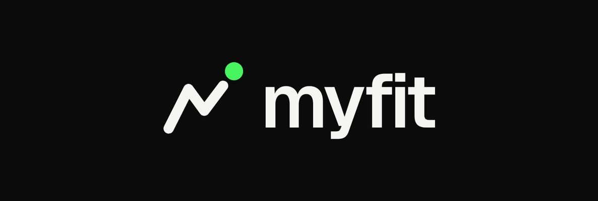
</p>

# MyFit

App Android pessoal e offline para montar treinos, executá-los com cronômetro confiável e acompanhar a evolução do corpo. Sem conta, sem servidor, sem anúncios.

> **Status:** `v1.0.0`: completo para uso diário. Roteiro de validação no celular em [`docs/TESTING.md`](docs/TESTING.md).

## Recursos

- **Treinos:** crie, edite, duplique, reordene (arrastar) e exclua sequências; séries, repetições, descanso, carga e observações por exercício.
- **Biblioteca:** 81 exercícios pré-definidos em PT-BR, busca sem acento, filtro por grupo muscular e exercícios personalizados com imagem da galeria.
- **Execução:** uma tela imersiva com séries, descanso automático, ±15 s, pausar/retomar, pular série/exercício, ajustar carga e repetições, resumo antes de salvar.
- **Cronômetro confiável:** tempos derivados de marcas persistidas (relógio monotônico + contador de boots); alarme exato no fim do descanso com som e vibração mesmo com a tela bloqueada; notificação contínua com ações rápidas; sessão recuperada se o app for fechado.
- **Histórico:** calendário mensal com dias treinados, sessões do dia, detalhe por série e resumos semanal/mensal.
- **Início:** próximo treino sugerido, seus treinos, última atividade, indicadores do corpo e a semana.
- **Evolução:** avaliações com peso, % de gordura e 14 circunferências, comparação entre duas datas (diferença com sinal), gráficos por indicador com período e fotos por data com comparação lado a lado.
- **Backup:** arquivo criptografado (AES-256-GCM, chave derivada da sua senha de recuperação) gravado numa pasta que você escolhe e mantém sincronizada com o Google Drive. Roda todo dia e após mudanças, guarda os 7 últimos e permite exportar e restaurar com validação de integridade.
- **Ajustes:** tema (escuro por padrão, claro ou do sistema), descanso padrão, som do descanso, tela ligada no treino, status de notificações e bateria.

## Telas

<p>
  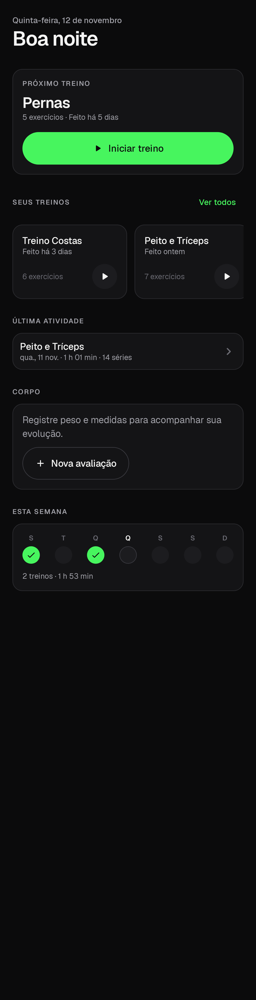
  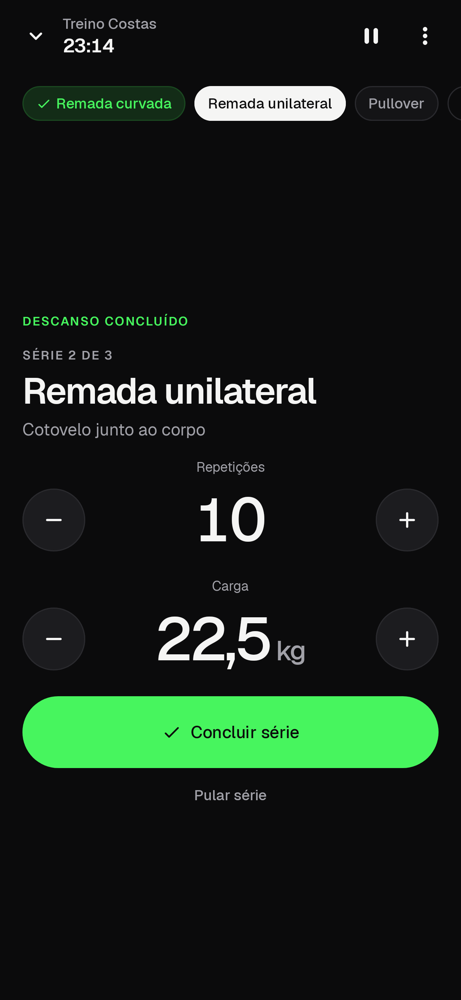
  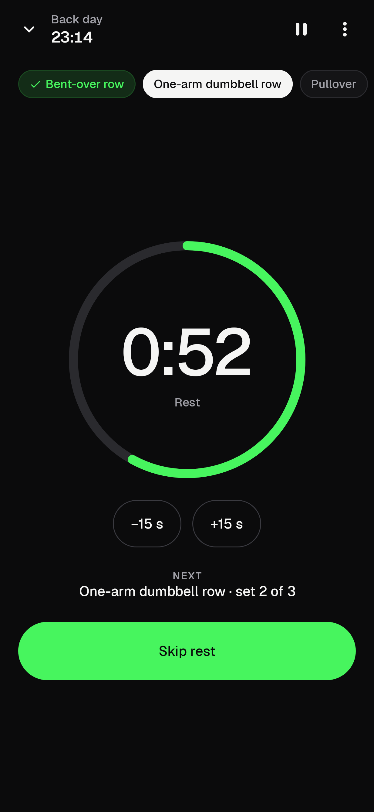
  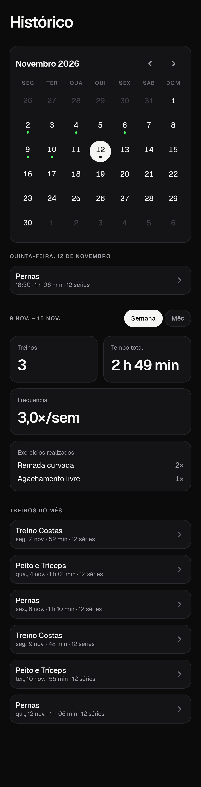
</p>
<p>
  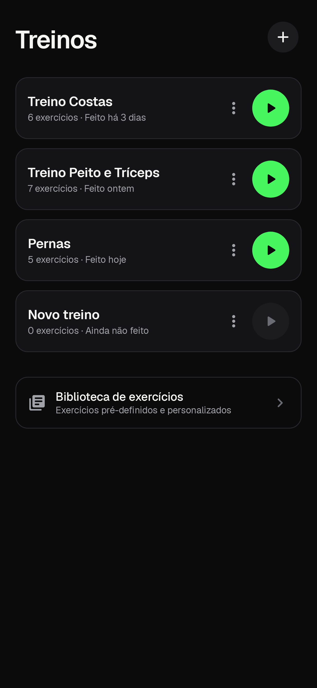
  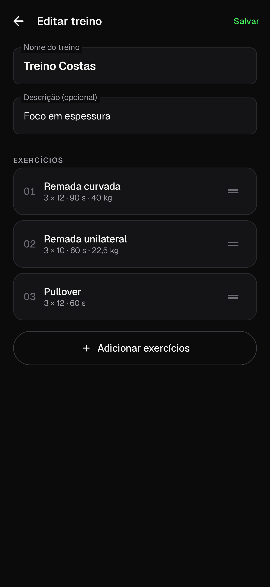
  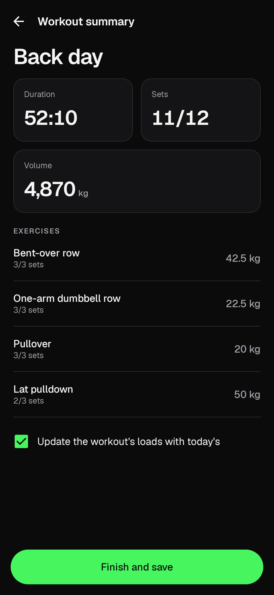
  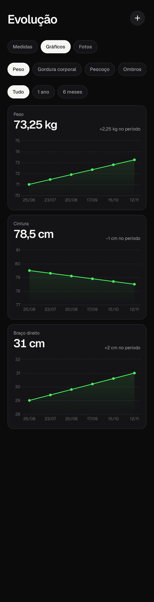
</p>
<p>
  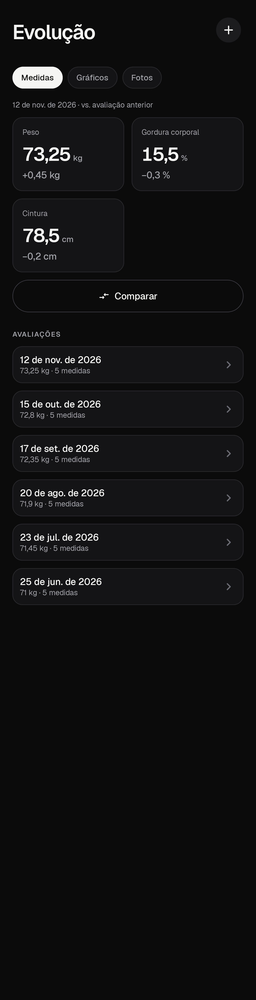
  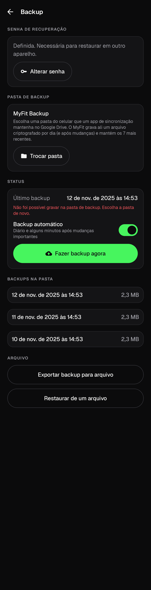
  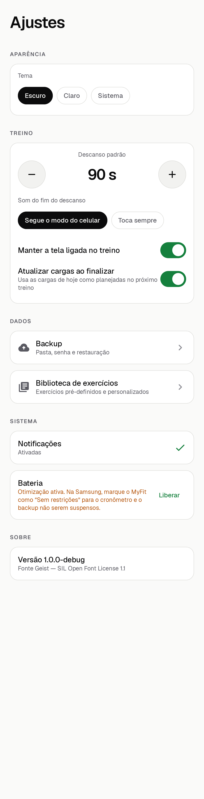
</p>

## Instalação no celular

Baixe o APK em [Releases](../../releases). Desde 30/09/2026 o Android exige desenvolvedor verificado para instalar apps fora da Play Store no Brasil; o MyFit é um app pessoal não registrado, então use um destes caminhos:

1. **ADB (imediato, recomendado):** ative *Opções do desenvolvedor → Depuração USB* (ou *Depuração sem fio*), conecte ao computador e rode `adb install -r myfit-<versão>.apk`. Instalações via ADB não passam pela verificação.
2. **Fluxo avançado (sem computador):** nas *Opções do desenvolvedor*, ative a permissão para apps de desenvolvedores não verificados; o Android pede reinício, espera de 24 h e nova autenticação. Depois disso, o APK instala tocando no arquivo.

Atualizações usam a mesma assinatura, então os dados são mantidos (`adb install -r` ou instalar por cima).

## Backup no Google Drive

1. *Ajustes → Backup → Definir senha*. Guarde a senha: sem ela não há como restaurar.
2. Crie uma pasta no celular (ex.: `MyFit Backup`) e mantenha-a sincronizada com o Drive por um app de sincronização de pastas.
3. *Escolher pasta* no MyFit. A partir daí ele grava `myfit-backup-AAAAMMDD-HHmmss.myfit` todo dia e alguns minutos após mudanças, e mantém os 7 mais recentes.
4. Para restaurar (por exemplo, num celular novo): instale o MyFit, sincronize a pasta, escolha-a em *Backup*, toque no arquivo desejado, confirme a data e digite a senha.

O MyFit não acessa a internet: o arquivo já sai criptografado do app.

**Samsung (One UI):** em *Configurações → Bateria → Limites de uso em segundo plano*, deixe o MyFit fora de "apps em suspensão" e marque a bateria do app como **Sem restrições**. Permita notificações quando o app pedir no primeiro treino.

## Desenvolvimento

Requisitos: JDK 21 e Android SDK (platform 37, build-tools 37.0.0). Sem Android Studio, tudo pela linha de comando:

```bash
export JAVA_HOME=~/.local/share/jdks/jdk-21.0.13+9
export ANDROID_HOME=~/Android/Sdk
echo "sdk.dir=$ANDROID_HOME" > local.properties

./gradlew assembleDebug            # APK de debug (io.github.luannamorim.myfit.debug)
./gradlew testDebugUnitTest        # testes (JVM + Robolectric)
./gradlew recordRoborazziDebug     # screenshots em app/build/outputs/roborazzi/
./gradlew lintDebug
./gradlew assembleRelease          # APK assinado (requer as propriedades MYFIT_* abaixo)
```

Assinatura de release (fora do repositório, em `~/.gradle/gradle.properties`):

```properties
MYFIT_STORE_FILE=/caminho/para/myfit-release.jks
MYFIT_STORE_PASSWORD=...
MYFIT_KEY_ALIAS=myfit
MYFIT_KEY_PASSWORD=...
```

Sem essas propriedades, o build de release sai sem assinatura.

## Stack

Kotlin 2.4 · Jetpack Compose + Material 3 (adaptive) · Navigation Compose (type-safe) · Hilt · Room · DataStore · WorkManager · Coil · Vico · Tink · Robolectric + Roborazzi. Um módulo `:app` em camadas: `ui/` → `domain/` ← `data/`, com serviços de plataforma em `platform/`.

## Documentação

- [`SPEC.md`](SPEC.md) — especificação
- [`IMPLEMENTATION_PLAN.md`](IMPLEMENTATION_PLAN.md) — etapas e tarefas
- [`docs/ARCHITECTURE.md`](docs/ARCHITECTURE.md) — arquitetura, modelo de tempo, formato do backup
- [`docs/TESTING.md`](docs/TESTING.md) — testes automáticos e roteiro manual no celular
- [`docs/BRAND.md`](docs/BRAND.md) — identidade visual

## Licenças

Código: uso pessoal. Fonte Geist: SIL Open Font License 1.1 ([`docs/licenses/GEIST_OFL.txt`](docs/licenses/GEIST_OFL.txt)).
