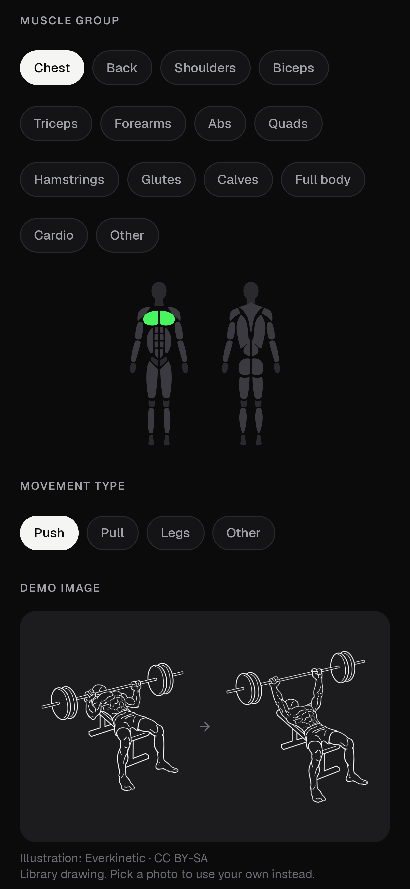
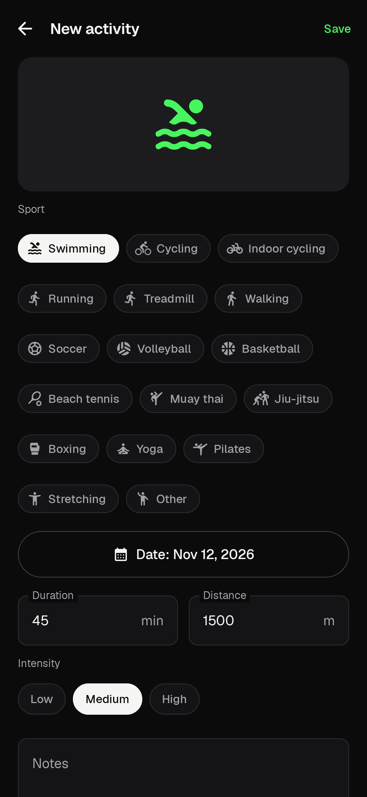
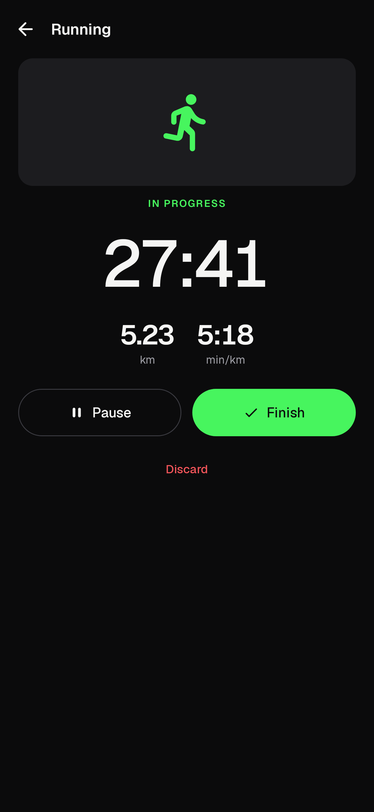
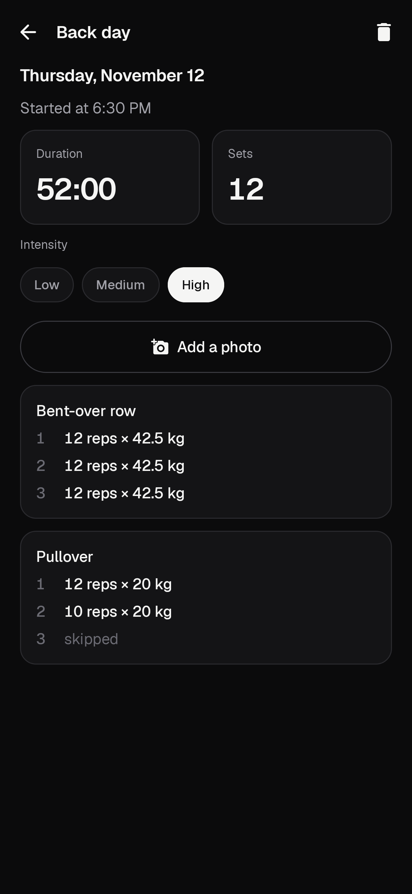
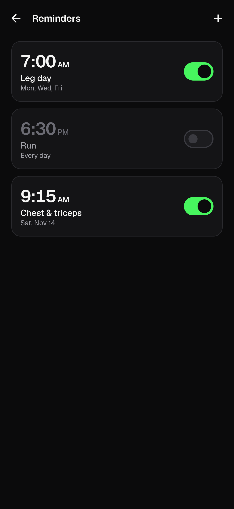

<p align="center">
  
</p>

# MyFit

A personal, offline Android app to plan workouts, run them with a reliable rest timer and track how your body changes. No account, no server, no ads. Available in English and Brazilian Portuguese.

## Features

- **Workouts:** create, edit, duplicate, reorder (drag) and delete exercise sequences, with sets, reps (or time per set for planks, holds and cardio), rest, load and notes per exercise.
- **Library:** 152 predefined exercises (in the device language), each with a line drawing of the start and end position. Accent-insensitive search, muscle-group filters and custom exercises with a photo from the gallery. A body map highlights the worked muscle group (also the picture of custom exercises without a photo), and *Watch how to do it* opens a video search in YouTube or the browser.
- **Workout mode:** an immersive screen with sets, automatic rest, ±15 s, pause/resume, skip set or exercise, adjustable load and reps, a countdown timer for timed sets (beeps at the end, keeps counting if you hold longer), and a summary before saving where you rate the intensity (low, medium or high) and can attach a photo (stored reduced).
- **Reliable timer:** times come from persisted marks (wall clock + monotonic clock + boot count), never from UI counters. An exact alarm ends the rest even with the screen locked: three beeps in the last 3 seconds, then MyFit's own sound and vibration (by default at alarm volume, so it rings even with the phone on vibrate). The ongoing notification has quick actions, and an interrupted session resumes where it stopped.
- **Other sports:** log swimming, cycling, indoor cycling, running, treadmill, walking, soccer, volleyball, basketball, beach tennis, muay thai, jiu-jitsu, boxing, yoga, pilates, stretching or a free activity you name, each with its figure, plus date, duration, distance, intensity, notes and a photo. Log them afterwards or time them live with *Start timer*: the clock survives a locked screen or a killed app, and outdoor sports (running, walking, cycling, free) can measure distance with the phone's GPS, offline and without storing the route. They show in History and in the week on Home.
- **History:** monthly calendar with training days, per-day workouts and activities, per-set details, intensity, and weekly/monthly summaries (workouts, activities, total time, frequency, exercises and sports).
- **Progress:** assessments with weight, body fat and 14 circumferences, comparison between two dates (signed differences), per-measure charts (or *All* at once) and dated photos, including older ones, that open full screen like a gallery (swipe, pinch to zoom) and can be compared side by side.
- **Backup:** an encrypted file (AES-256-GCM streaming, key derived from your recovery password) written to a folder you pick and keep in sync with Google Drive (or any cloud) through a sync app. Runs daily and after changes, keeps the last 7, and supports export and restore with integrity checks.
- **Settings:** dark (default), light or system theme, default rest, rest sound, workout reminders (date and time, or repeating on weekdays), keep screen on, notification and battery status.

## Screenshots

<p>
  
  
  
  
</p>
<p>
  
  
  
  
</p>
<p>
  
  
  
  
</p>
<p>
  
  
  
  
</p>

## Install

Download the APK from [Releases](../../releases). MyFit is not on the Play Store and is not registered with Android developer verification, which is enforced in some countries (e.g. Brazil since September 2026). Use one of these:

1. **ADB:** enable *Developer options → USB debugging* (or *Wireless debugging*), connect the phone and run `adb install -r myfit-<version>.apk`. ADB installs are not subject to verification.
2. **Advanced flow:** in *Developer options*, allow apps from unverified developers. Android asks for a restart, a 24-hour wait and re-authentication; after that the APK installs from the file manager.

Updates are signed with the same key, so `adb install -r` (or installing over) keeps your data.

**Samsung (One UI) and other aggressive battery savers:** set MyFit's battery usage to **Unrestricted** (*Settings → Battery* inside the app links to it) and allow notifications when asked on your first workout.

## Backup to Google Drive (or any cloud)

1. *Settings → Backup → Set password*. Keep it safe: backups cannot be restored without it.
2. Create a folder on the phone (e.g. `MyFit Backup`) and keep it synced with your cloud using a folder-sync app.
3. *Choose folder* in MyFit. From then on it writes `myfit-backup-YYYYMMDD-HHmmss.myfit` every day and a few minutes after changes, keeping the 7 most recent.
4. To restore (e.g. on a new phone): install MyFit, sync the folder, choose it under *Backup*, tap a file, confirm the date and enter the password.

MyFit itself never touches the network: files are already encrypted when they leave the app.

## Build

Requirements: JDK 21 and the Android SDK (platform 37, build-tools 37.0.0). Everything works from the command line:

```bash
export JAVA_HOME=/path/to/jdk-21 ANDROID_HOME=/path/to/Android/Sdk
echo "sdk.dir=$ANDROID_HOME" > local.properties

./gradlew assembleDebug            # debug APK (io.github.luannamorim.myfit.debug)
./gradlew testDebugUnitTest        # tests (JVM + Robolectric)
./gradlew recordRoborazziDebug     # screenshots in app/build/outputs/roborazzi/
./gradlew lintDebug
./gradlew assembleRelease          # signed APK (needs the MYFIT_* properties below)
```

Release signing reads these from `~/.gradle/gradle.properties` (never commit them). Without them the release build is unsigned:

```properties
MYFIT_STORE_FILE=/path/to/myfit-release.jks
MYFIT_STORE_PASSWORD=...
MYFIT_KEY_ALIAS=myfit
MYFIT_KEY_PASSWORD=...
```

## Tech stack

Kotlin 2.4 · Jetpack Compose + Material 3 (adaptive) · Navigation Compose (type-safe) · Hilt · Room · DataStore · WorkManager · Coil · Vico · Tink · JUnit, Robolectric and Roborazzi. A single `:app` module in layers: `ui/` → `domain/` ← `data/`, with platform services in `platform/`.

## Documentation

- [`SPEC.md`](SPEC.md): product specification
- [`IMPLEMENTATION_PLAN.md`](IMPLEMENTATION_PLAN.md): stages and tasks
- [`docs/ARCHITECTURE.md`](docs/ARCHITECTURE.md): architecture, time model, backup format
- [`docs/TESTING.md`](docs/TESTING.md): automated tests and the on-device checklist
- [`docs/BRAND.md`](docs/BRAND.md): visual identity

## License

[MIT](LICENSE), except for bundled third-party content:

- **Geist font:** SIL Open Font License 1.1 ([`docs/licenses/GEIST_OFL.txt`](docs/licenses/GEIST_OFL.txt)).
- **Exercise illustrations** (`app/src/main/assets/exercises/`): CC BY-SA 4.0, by [Everkinetic](https://github.com/everkinetic/data) and by Bryl Lim ([Workout Guide](https://github.com/bryllim/workout-guide)); one drawing via [wger](https://wger.de) under CC BY-SA 3.0. They were cropped, scaled and converted by [`tools/exercise_art.py`](tools/exercise_art.py); see the folder's [`NOTICE.md`](app/src/main/assets/exercises/NOTICE.md) and *Settings → Image credits* in the app.
- **Rest countdown beep** (`app/src/main/res/raw/rest_tick.wav`): from [SoundJay.com](https://www.soundjay.com), trimmed and leveled; not covered by the MIT license.
